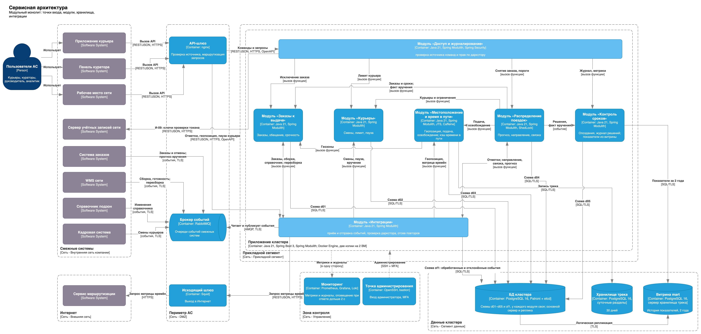

# Распределение поездок курьеров в кластере дарксторов

Проект системы, которая решает, **куда ехать курьеру** после вручения последнего заказа и **что ему везти**, когда три соседних даркстора делят общий пул курьеров. Путь от требований до проверенной на стенде базы данных: требования, архитектура, интеграции, решения с альтернативами, модель данных, витрина для аналитики.

Учебный проект, РТУ МИРЭА (Прикладная информатика), 2026. Выполнен самостоятельно. Автор — Никита Джахнаев, Telegram [@snnvw](https://t.me/snnvw).

## Результаты

- **45 функциональных и 8 нефункциональных требований** с критериями приёмки и журналом изменений
- **Модульный монолит** на 5 доменных модулей и 2 общесистемных, 9 интеграций, C4-схемы
- **17 архитектурных решений (ADR)**: у каждого критерии, отвергнутые варианты и цена решения
- **27 таблиц в НФБК**, 3 осознанные денормализации, 8 индексов, у каждого замер «до/после»
- **Стенд PostgreSQL**, данные за 90 дней (405 тыс. заказов, 12,9 млн точек трека):
  - самый частый запрос: **47,6 → 0,12 мс**
  - ночное удаление по сроку хранения: **58,7 с → 83 мс**
  - вся работа с БД при выдаче направления: **1,35 мс по p95** при лимите 2 с
  - миграция проверена с откатом, контрольные суммы совпали
- **Витрина «звезда»** с версионными измерениями (SCD2), проверками качества и паспортом из 6 метрик

## Документы

| | |
|---|---|
| [01. Контекст и предметная область](docs/01-context.md) | Задача, правила, домены, словарь |
| [02. Требования](docs/02-requirements.md) | ФТ, НФТ, критерии приёмки, диаграммы использования |
| [03. Интеграции](docs/03-integrations.md) | Реестр И-01…И-09, граница доверия, риски |
| [04. Архитектура](docs/04-architecture.md) | Драйверы, выбор модульного монолита, C4, размещение |
| [05. Доступ и защита данных](docs/05-security.md) | Роли и права, классы данных, сегменты, угрозы |
| [06. Модель данных](docs/06-data-model.md) | ER, нормализация, индексы, миграция |
| [07. Сквозной сценарий](docs/07-scenario-fr027.md) | Диаграммы последовательности: успех, повтор, таймаут, смена в пути, события |
| [08. Витрина данных](docs/08-analytics-mart.md) | Поток ELT, звезда, контроль качества, метрики |
| [09. Кэш и отказы](docs/09-cache-and-failures.md) | Что кэшировать, параметры, таблица отказов |
| [ADR](docs/adr/README.md) | 17 решений |
| [Стенд БД](db/README.md) | Как воспроизвести замеры |

## Стек решения

Java 21, Spring Boot 3, Spring Modulith · PostgreSQL 16 (Patroni), логическая репликация, pg_cron · RabbitMQ · nginx, Squid · Caffeine · Prometheus, Grafana, Loki · Docker. Стенд — PostgreSQL 17, SQL, Python, pgbench.

Исходники схем — `docs/diagrams/src/*.drawio` (draw.io).

## Лицензия

[MIT](LICENSE)
