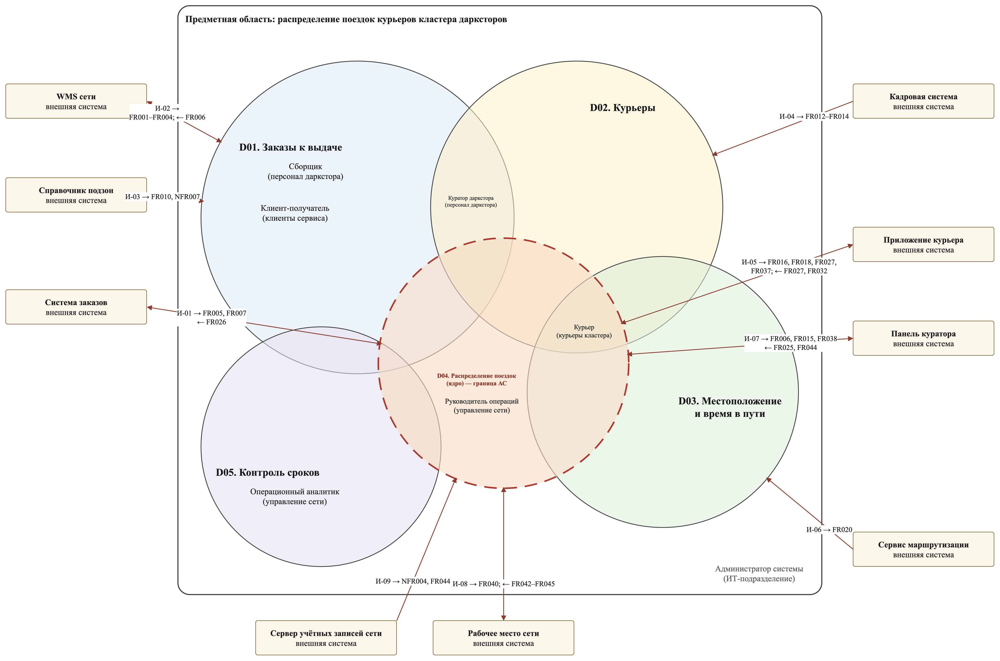

# Контекст и предметная область

## Задача

Сеть доставки продуктов работает из дарксторов — складов без торгового зала. Три соседних даркстора объединены в **кластер** с общим пулом курьеров. У каждого курьера есть базовый даркстор, но в пик один даркстор захлёбывается заказами, а у соседнего простаивают курьеры.

Система отвечает на два вопроса:

1. **Куда ехать курьеру** после вручения последнего заказа поездки — на даркстор кластера с наименьшим прогнозом опозданий (при равенстве — на базовый).
2. **Что ему везти** — связку готовых заказов одной подзоны с учётом лимита, веса и срочности.

## Правила предметной области

- Направление на соседний даркстор выдаётся только после вручения последнего заказа поездки; пока в поездке есть невручённый заказ — только на даркстор отправления.
- Соседний даркстор не рассматривается, если подача курьера к нему больше 40 % обещания (обещание — время от оформления до крайнего срока).
- Если направление не рассчитано за 2 секунды, курьер едет на базу — система не заставляет его ждать.
- Отказаться от направления нельзя; вместо отказа есть пауза, которая включается после поездки.
- Куратор даркстора может снять заказ со связки, но не может назначить его курьеру — назначает только система.
- Заказы, которые ещё собираются, учитываются в прогнозе по ожидаемому времени готовности от WMS: нехватка курьеров видна до того, как заказы готовы.
- Связка — заказы одного даркстора и одной подзоны; в напряжённом режиме допускаются соседние подзоны.

## Домены

| Домен | Что решает | Тип |
|---|---|---|
| D01 Заказы к выдаче | Заказы в сборке и готовые, обещание и срочность, состав кластера | Поддерживающий |
| D02 Курьеры | Смена, базовый даркстор, лимит, пауза | Поддерживающий |
| D03 Местоположение и время в пути | Геопозиция, геозоны, подача, прогноз освобождения | Поддерживающий |
| **D04 Распределение поездок** | Прогноз опозданий, направление, связка, выдача | **Ядро** |
| D05 Контроль сроков | Опоздания и их причины, журнал решений, точность прогнозов | Поддерживающий |

Граница системы совпадает с границей ядра D04: остальные домены входят в систему настолько, насколько их данные нужны для решения. D05 не пересекается с D02 и D03, D01 — с D03.

## Нагрузка (пик кластера)

3 даркстора, до 100 курьеров на смене, до 600 действующих заказов, до 20 отметок о вручении в минуту, геопозиция каждые 10 секунд (~10 сообщений в секунду). За 90 дней — около 405 тыс. заказов и 13 млн точек трека за 30 дней.

## Словарь

| Термин | Значение |
|---|---|
| Даркстор | Склад без торгового зала, с которого курьеры развозят заказы |
| Кластер | Три соседних даркстора с общим пулом курьеров |
| Подзона | Часть зоны доставки даркстора; связка собирается внутри одной подзоны |
| Обещание | Время от оформления заказа до крайнего срока; пороги задаются в долях обещания |
| Направление | Решение, на какой даркстор едет курьер после вручения последнего заказа |
| Связка | Заказы одной подзоны, которые курьер увозит за одну поездку |
| Подача | Время в пути курьера до даркстора с учётом его личного коэффициента скорости |
| Прогноз опозданий | Сколько заказов даркстора опоздают на горизонте одного обещания; пересчитывается не реже раза в 20 с |
| Напряжённый режим | Состояние даркстора, когда прогноз показывает опоздания |
| ФП-1…ФП-5 | Функциональные подсистемы (модули) по доменам D01–D05 |
| ОФ-1, ОФ-2 | Общесистемные модули: «Интеграции»; «Доступ и журналирование» |
| И-01…И-09 | Интеграции со смежными системами, см. [реестр](03-integrations.md) |
| K1–K3 | Классы данных по ущербу при компрометации, см. [защиту данных](05-security.md) |
| Г1–Г4, F-01…F-09 | Границы доверия и внешние потоки на схеме сетевых сегментов |
