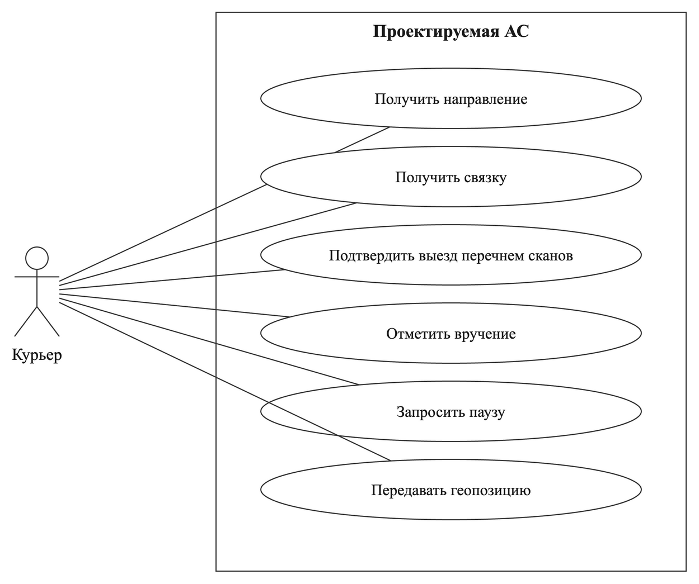
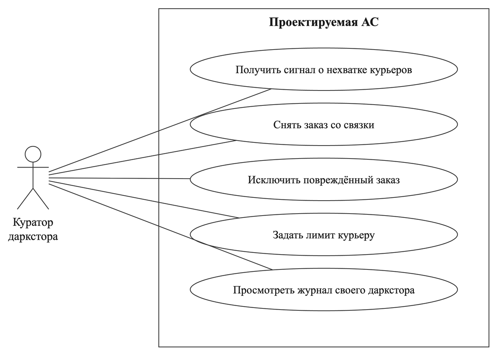
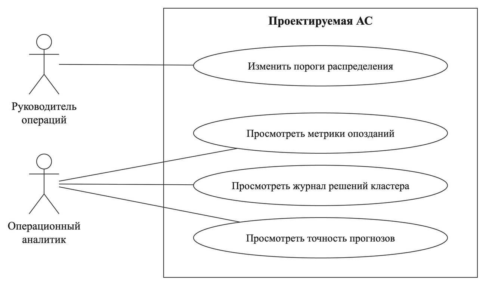

# Требования

Каталог: **45 функциональных** и **8 нефункциональных** требований. Каждое требование привязано к домену и поддомену (`D04-S02-FR027`: домен D04, поддомен S02, сквозной номер 027), описывает одно проверяемое поведение и имеет критерий приёмки.

- [Роли заказчика](#роли-заказчика)
- [Диаграммы использования](#диаграммы-использования)
- [Функциональные требования](#функциональные-требования)
- [Нефункциональные требования](#нефункциональные-требования)
- [Журнал изменений требований](#журнал-изменений-требований)

## Роли заказчика

| Роль | Участие в требованиях |
|---|---|
| Руководитель операций сети | Владелец правил распределения; ответственный за требования доменов D02–D04 |
| Руководитель складских операций | Владелец данных о сборке; ответственный за требования о заказах в сборке и готовности |
| Логистика сети | Владелец справочника подзон и матрицы времён; ответственный за требования о подзонах и времени в пути |
| Кадровая служба | Владелец данных о сменах; ответственный за требования о начале и окончании смены |
| Операционный аналитик | Владелец метрик; ответственный за требования домена D05 |
| Куратор даркстора | Интересант: получает сигналы, снимает заказы, задаёт лимиты |
| Курьер | Интересант: получает направления и связки, запрашивает паузу |

## Диаграммы использования

У системы нет собственного интерфейса: курьер работает через приложение курьера, куратор — через панель куратора, управление сети — через рабочее место сети.

| Курьер | Куратор даркстора | Роли уровня сети |
|---|---|---|
|  |  |  |

Курьер не выбирает заказы и не может отказаться от направления. Куратор может снять заказ со связки и задать лимит, но не назначить заказ курьеру.

## Функциональные требования

| ID | Требование | Ответственный | Критерий приёмки |
|---|---|---|---|
| `D01-S01-FR001` | При получении от WMS события начала сборки система учитывает заказ в прогнозе его даркстора с ожидаемым временем готовности | Руководитель складских операций | Заказ виден в прогнозе как «в сборке» и не попадает в связку до события готовности |
| `D01-S01-FR002` | При получении от WMS нового ожидаемого времени готовности система заменяет его в прогнозе | Руководитель складских операций | После события в прогнозе действует новое время, старое не используется |
| `D01-S01-FR003` | Если ожидаемое время готовности прошло, а событие готовности не поступило, система отмечает заказ как задерживающийся в сборке и сдвигает его готовность на 2 минуты в каждом цикле прогноза | Руководитель складских операций | Через 2 минуты после просроченной готовности заказ отмечен, ожидаемое время сдвинуто |
| `D01-S02-FR004` | При получении от WMS события готовности система переводит заказ в пул готовых заказов его даркстора | Руководитель складских операций | Заказ в пуле своего даркстора, в пулах других дарксторов отсутствует |
| `D01-S02-FR005` | При получении от системы заказов отмены заказа система исключает заказ из прогноза, пула и связки, если доставка ещё не начата | Руководитель операций сети | Отменённый заказ не входит ни в пул, ни в связку |
| `D01-S02-FR006` | По команде куратора исключить повреждённый заказ система убирает заказ из пула и сообщает WMS о возврате на пересборку | Руководитель складских операций | Заказ исключён из пула, WMS получила сообщение |
| `D01-S03-FR007` | При получении заказа система вычисляет обещание как разность крайнего срока и времени оформления | Руководитель операций сети | Для заказа с оформлением 19:00 и сроком 19:30 обещание равно 30 минутам |
| `D01-S03-FR008` | Если прогноз вручения заказа позже крайнего срока, система присваивает заказу признак «под угрозой» | Руководитель операций сети | Признак появляется при прогнозе позже срока и снимается при прогнозе в срок |
| `D01-S03-FR009` | Если крайний срок прошёл, а заказ не вручён, система присваивает заказу признак «просрочен» | Руководитель операций сети | Через минуту после срока у невручённого заказа есть признак |
| `D01-S04-FR010` | Система обновляет состав кластера, подзоны и их соседство из справочника подзон раз в сутки и при изменении справочника | Логистика сети | Изменение справочника отражается в системе не позже следующего обновления |
| `D01-S04-FR011` | При получении события с даркстором вне кластера система отклоняет событие и записывает причину в журнал приёма | Руководитель операций сети | Событие чужого даркстора не создаёт заказ, причина записана |
| `D02-S01-FR012` | При получении из кадровой системы допуска курьера к смене система учитывает курьера с базовым даркстором, концом смены и типом транспорта | Кадровая служба | Курьер участвует в прогнозе с указанными параметрами |
| `D02-S01-FR013` | При получении из кадровой системы окончания смены система прекращает выдачу курьеру направлений | Кадровая служба | После окончания смены направления курьеру не выдаются |
| `D02-S01-FR014` | Если до конца смены курьера меньше одного обещания, система выдаёт ему направление только на базовый даркстор | Руководитель операций сети | За 25 минут до конца смены при обещании 30 минут направление только на базу |
| `D02-S02-FR015` | По команде куратора система устанавливает личный лимит заказов курьера | Руководитель операций сети | Новый лимит применяется к следующей связке курьера |
| `D02-S03-FR016` | При получении от приложения курьера запроса паузы система включает её после вручения последнего заказа поездки и не выдаёт курьеру направление до окончания паузы | Руководитель операций сети | Текущая поездка не меняется; после вручения направление не выдаётся до конца паузы |
| `D02-S03-FR017` | Если курьер увёз связку из одного заказа весом от 35 кг, система ставит его первым в очередь своего даркстора при следующем прибытии | Руководитель операций сети | После рейса с тяжёлым заказом курьер получает связку раньше прибывших до него |
| `D03-S01-FR018` | При получении геопозиции курьера на смене система сохраняет последнюю точку и время её получения | Руководитель операций сети | Последняя точка и время обновляются при каждом сообщении |
| `D03-S01-FR019` | При входе курьера в геозону даркстора система фиксирует прибытие курьера на даркстор | Логистика сети | Точка внутри геозоны создаёт отметку прибытия |
| `D03-S02-FR020` | Система рассчитывает подачу курьера как время из матрицы от его последней точки до даркстора, умноженное на личный коэффициент скорости | Логистика сети | Расчёт совпадает с ручным по матрице и коэффициенту |
| `D03-S02-FR021` | Раз в сутки система пересчитывает личный коэффициент скорости курьера по его фактическим поездкам за 14 дней | Логистика сети | После ночного пересчёта коэффициент отражает новые поездки |
| `D03-S03-FR022` | Для курьера в доставке система рассчитывает прогноз освобождения как время вручения оставшихся заказов и подачу до базового даркстора | Руководитель операций сети | Прогноз освобождения меняется при каждом вручении |
| `D04-S01-FR023` | По каждому событию о заказе или курьере и не реже раза в 20 секунд система пересчитывает прогноз опозданий по каждому даркстору кластера на горизонте одного обещания | Руководитель операций сети | Интервал между пересчётами в журнале не превышает 20 секунд |
| `D04-S01-FR024` | Если прогноз даркстора показывает опоздания, система переводит даркстор в напряжённый режим | Руководитель операций сети | При прогнозе опозданий даркстор в напряжённом режиме, при их отсутствии — нет |
| `D04-S01-FR025` | Если прогноз даркстора показывает опоздания, система отправляет куратору даркстора сигнал с числом заказов под угрозой и причиной | Руководитель операций сети | Куратор получает сигнал с числом заказов и причиной |
| `D04-S01-FR026` | При появлении признака «под угрозой» и при сдвиге прогноза вручения больше чем на 10 % обещания система передаёт прогноз вручения в систему заказов | Руководитель операций сети | Система заказов получает номер заказа и прогнозное время |
| `D04-S02-FR027` | При получении от приложения курьера отметки о вручении последнего заказа поездки система выдаёт курьеру направление на даркстор с наименьшим прогнозным числом опозданий; при равенстве — на базовый | Руководитель операций сети | При равных прогнозах — база; при меньшем прогнозе у соседа — сосед |
| `D04-S02-FR028` | Система не рассматривает соседний даркстор, если подача курьера к нему больше 40 % обещания | Руководитель операций сети | При подаче 14 минут и обещании 30 минут сосед не рассматривается |
| `D04-S02-FR029` | Если направление не рассчитано за 2 секунды, система отправляет курьеру направление на базовый даркстор и записывает причину в журнал | Руководитель операций сети | При искусственной задержке расчёта курьер получает базу, причина в журнале |
| `D04-S02-FR030` | Пока курьер едет, система меняет его направление только если новый вариант уменьшает прогноз опозданий хотя бы на один заказ, и не больше одного раза за возврат | Руководитель операций сети | Без выигрыша направление не меняется; второе изменение не выдаётся |
| `D04-S02-FR031` | Если в поездке курьера есть невручённый заказ, система выдаёт направление только на даркстор отправления | Руководитель операций сети | При невручённом заказе направление только на даркстор отправления |
| `D04-S03-FR032` | При прибытии курьера на даркстор система составляет связку из готовых заказов одной подзоны с учётом лимита, веса и порядка срочности | Руководитель операций сети | Связка не превышает лимит, первым идёт самый срочный из успевающих заказов |
| `D04-S03-FR033` | Система включает заказ, просроченный больше чем на 25 % обещания, в ближайшую связку своего даркстора | Руководитель операций сети | Такой заказ уезжает со следующей связкой даркстора |
| `D04-S03-FR034` | В напряжённом режиме система допускает в связку заказы соседних подзон | Руководитель операций сети | В напряжённом режиме связка может включать соседние подзоны, в обычном — нет |
| `D04-S03-FR035` | Система задерживает выезд курьера не дольше 10 % обещания, если заказ той же подзоны будет готов и войдёт в связку без нарушения сроков | Руководитель операций сети | Задержка не превышает 3 минут при обещании 30 |
| `D04-S03-FR036` | Система включает заказ весом от 35 кг в связку отдельно от других заказов | Руководитель операций сети | Связка с заказом от 35 кг содержит только его |
| `D04-S04-FR037` | При получении от приложения курьера отметки о начале доставки система фиксирует выезд, только если перечень отсканированных заказов совпадает с составом связки; иначе отклоняет отметку с указанием расхождения | Руководитель операций сети | Неполный или лишний перечень отклонён; полный фиксирует выезд |
| `D04-S04-FR038` | По команде куратора система снимает заказ со связки и возвращает его в пул с прежним крайним сроком | Руководитель операций сети | Снятый заказ в пуле, срок не изменился |
| `D04-S04-FR039` | Если заказ связки не отсканирован в течение 5 минут после прибытия курьера, система снимает его со связки и возвращает в пул | Руководитель операций сети | Через 5 минут ненайденный заказ снова в пуле |
| `D04-S05-FR040` | По команде руководителя операций система изменяет пороги распределения в долях обещания; изменение действует со следующего пересчёта прогноза | Руководитель операций сети | Новый порог применяется к решениям после изменения |
| `D05-S01-FR041` | При получении отметки о вручении система записывает фактическое опоздание как разность времени вручения и крайнего срока | Операционный аналитик | Опоздание равно разности времени вручения и срока |
| `D05-S01-FR042` | Система относит каждое опоздание к одной причине: до распределения, нехватка курьеров, решение распределения или в доставке | Операционный аналитик | У каждого опоздания ровно одна причина |
| `D05-S02-FR043` | Для каждого направления система записывает в журнал рассмотренные варианты, их прогноз опозданий и выбранный вариант | Операционный аналитик | Запись журнала содержит все варианты и выбор |
| `D05-S02-FR044` | Система предоставляет куратору записи журнала только его даркстора, а рабочему месту сети — записи всего кластера | Операционный аналитик | Куратор не видит записи чужого даркстора |
| `D05-S03-FR045` | Раз в сутки система рассчитывает среднюю ошибку прогнозов готовности, освобождения и подачи по сравнению с фактом | Операционный аналитик | Отчёт за сутки содержит три значения ошибки |

## Нефункциональные требования

| ID | Требование | Порог и условия проверки | Ответственный |
|---|---|---|---|
| `D04-S02-NFR001` | От получения системой отметки о вручении последнего заказа до отправки направления проходит не более 2 секунд | Кластер из трёх дарксторов, до 100 курьеров, до 600 заказов, до 20 отметок в минуту | ИТ-подразделение сети (внешняя ответственность) |
| `D04-S04-NFR002` | Сбой при составлении или выдаче связки не приводит к потере заказа: заказ находится ровно в одном состоянии | Ни одного заказа вне состояний или в двух связках после прерывания операции | ИТ-подразделение сети (внешняя ответственность) |
| `D03-S01-NFR003` | Геопозиция курьера собирается только во время смены и хранится не дольше 30 дней | После окончания смены точки не сохраняются; старше 30 дней удаляются | Служба ИБ сети (внешняя ответственность) |
| `D04-S04-NFR004` | Курьер получает только свои направления и связки, куратор — данные только своего даркстора | Запрос чужих данных отклоняется | Служба ИБ сети (внешняя ответственность) |
| `D04-S01-NFR005` | Система работает круглосуточно | Доступность не менее 99,5 % времени в месяц | ИТ-подразделение сети (внешняя ответственность) |
| `D01-S01-NFR006` | Повторно полученное событие не создаёт второй заказ и не меняет состояние повторно | Повтор события 10 раз даёт один заказ | ИТ-подразделение сети (внешняя ответственность) |
| `D01-S04-NFR007` | Добавление даркстора в кластер выполняется изменением справочника без изменения правил | Четвёртый даркстор участвует в направлениях после обновления справочника | ИТ-подразделение сети (внешняя ответственность) |
| `D05-S02-NFR008` | Записи журнала решений хранятся не менее 90 дней | Запись 90-дневной давности доступна | ИТ-подразделение сети (внешняя ответственность) |

## Журнал изменений требований

Требования, формулировка которых менялась при проектировании, и причина изменения.

| ID | Кто уточнил | Кто согласовал | Основание изменения |
|---|---|---|---|
| D04-S02-FR027 | Руководитель операций сети | Куратор даркстора | Выбор «ближайший курьер» заменён выбором по прогнозу опозданий в кластере: ближайший курьер не учитывает нехватку на соседнем дарксторе |
| D01-S01-FR001 | Руководитель операций сети | Руководитель складских операций | Добавлен учёт заказов в сборке: без него нехватка обнаруживается только после готовности заказов |
| D02-S03-FR016 | Руководитель операций сети | Куратор даркстора | Отказ от направления запрещён; вместо него введена пауза, включаемая после поездки |
| D04-S02-FR028 | Руководитель операций сети | Куратор даркстора | Фиксированный порог 12 минут заменён долей обещания 40 % |
| D04-S02-FR029 | Руководитель операций сети | Администратор системы | Добавлено поведение при превышении времени расчёта: направление на базу |
| D04-S04-FR037 | Руководитель операций сети | Куратор даркстора | Требование к сканированию переписано как проверка выезда: сканирование выполняет приложение курьера, связкой владеет АС |
| D04-S04-FR038 | Руководитель операций сети | Куратор даркстора | Уточнены полномочия куратора: может снять заказ, но не назначить |
