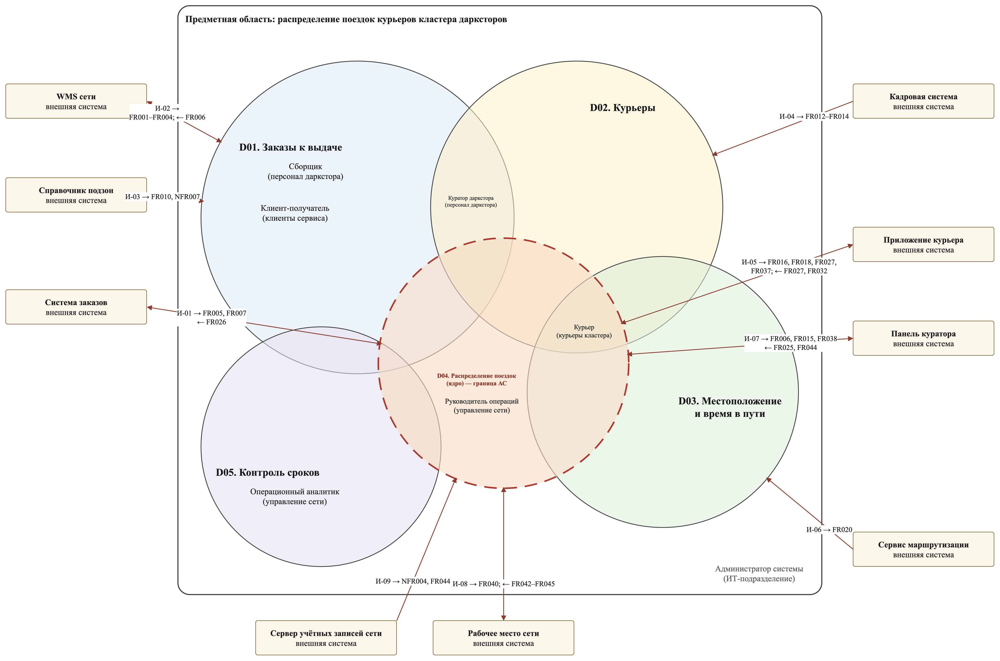

# Интеграции

Система — вычислительное ядро без собственного интерфейса: факты приходят из смежных систем, результат уходит обратно. Граница системы одновременно является границей доверия: данные смежных систем принимаются как факты и не исправляются, личность пользователя подтверждает сервер учётных записей, а право действовать в отношении даркстора проверяет сама система.

## Реестр интеграций

| ID | Система и владелец | Основание | Данные и направление | Триггер, частота | Владелец контракта |
|---|---|---|---|---|---|
| И-01 | Система заказов; владелец продукта «Заказы» | FR005, FR007, FR026, NFR006 | → заказ оформлен: номер, даркстор, подзона, крайний срок, время оформления; отмена заказа. ← прогноз вручения | По событию; прогноз — при угрозе опоздания, не чаще раза в 2 мин на заказ | Владелец продукта «Заказы»; исходящий — Руководитель операций сети |
| И-02 | WMS сети; руководитель складских операций | FR001–FR004, FR006, NFR006 | → сборка начата и ожидаемое время готовности, обновление времени, заказ собран, вес. ← заказ на пересборку | По событию | Руководитель складских операций; исходящий — Руководитель операций сети |
| И-03 | Справочник подзон; логистика сети | FR010, FR019, NFR007 | → дарксторы кластера, геозоны, подзоны и их соседство | Раз в сутки и при изменении | Логистика сети |
| И-04 | Кадровая система; кадровая служба | FR012–FR014 | → допуск к смене, базовый даркстор, конец смены, тип транспорта | При начале и окончании смены | Кадровая служба |
| И-05 | Приложение курьера; владелец продукта «Приложение курьера» | FR016, FR018, FR027, FR029, FR032, FR037, FR041, NFR001, NFR003 | → геопозиция, отметки вручения, перечень сканов, запрос паузы. ← направление, связка | По действию курьера; геопозиция раз в 10 с на смене | Владелец продукта; исходящий — Руководитель операций сети |
| И-06 | Сервис маршрутизации; внешний поставщик | FR020 | ← запрос пересчёта; → матрица времён в пути | Раз в сутки ночью | Логистика сети |
| И-07 | Панель куратора; владелец продукта «Панель куратора» | FR006, FR015, FR025, FR038, FR044, NFR004 | → снятие и исключение заказа, лимит курьера. ← сигналы, журнал своего даркстора | По действию куратора; сигналы сразу | Владелец продукта; исходящий — Руководитель операций сети |
| И-08 | Рабочее место сети; управление сети | FR040, FR042–FR045, NFR008 | → параметры распределения. ← метрики, журнал, точность прогнозов | По изменению параметров и по запросу | Руководитель операций сети |
| И-09 | Сервер учётных записей сети; ИТ-подразделение сети | NFR004, FR044 | → ключи проверки подписи токенов; в токене пользователя — идентификатор, роль и даркстор | Ключи — при запуске и смене; токен — в каждом запросе интерфейса | ИТ-подразделение сети |

Контракты: синхронные вызовы — [`api/openapi.yaml`](api/openapi.yaml), события брокера — [`api/asyncapi.yaml`](api/asyncapi.yaml).

## Граница доверия и риски

| ID | Граница и доверие | Риск недоступности или изменения контракта |
|---|---|---|
| И-01 | В АС только номер, подзона и сроки, без адреса клиента; повтор события отбрасывается | Новые заказы не появляются, известные распределяются; прогнозы отправляются после восстановления |
| И-02 | Время готовности принимается как факт; проверяется даркстор кластера | Заказы не переходят в «готов», связки не собираются; кураторы получают сигнал |
| И-03 | Справочник только читается | Работа на последней сохранённой версии |
| И-04 | Смены только читаются | Новые смены не открываются, текущие продолжаются |
| И-05 | Устройство курьера аутентифицируется; геопозиция — персональные данные | Распределение невозможно; приложение включает аварийный ручной режим |
| И-06 | Матрица только читается, вне цикла распределения | Работа на последней матрице |
| И-07 | Права куратора ограничены его даркстором | Распределение идёт автоматически, команды ждут |
| И-08 | Параметры меняет только руководитель операций | Действуют текущие параметры, метрики доступны позже |
| И-09 | Роль и даркстор берутся только из подписанного токена; пароли в АС не поступают | Новые входы невозможны; сохранённые ключи действуют до смены, распределение идёт автоматически |

## Какие требования зависят от смежных систем

Каждое требование проверено вопросом: можно ли выполнить его только на данных, которые система хранит или вычисляет сама.

| Поддомен | Требования с внешним обменом | Без внешнего обмена |
|---|---|---|
| D01-S01 Заказы в сборке | И-02 → FR001, FR002 | FR003 |
| D01-S02 Пул готовых заказов | И-02 → FR004; И-01 → FR005; И-07 → FR006, И-02 ← FR006 | — |
| D01-S03 Обещание и срочность | И-01 → FR007 | FR008, FR009 |
| D01-S04 Дарксторы и подзоны | И-03 → FR010, NFR007 | FR011 |
| D02-S01 Смена и базовый даркстор | И-04 → FR012, FR013, FR014 | — |
| D02-S02 Лимит, транспорт, вес | И-07 → FR015 | — |
| D02-S03 Пауза и компенсация | И-05 → FR016 | FR017 |
| D03-S01 Геопозиция и геозоны | И-05 → FR018, NFR003; И-03 → FR019 | — |
| D03-S02 Время в пути | И-06 → FR020 | FR021 |
| D03-S03 Прогноз освобождения | — | FR022 |
| D04-S01 Прогноз загрузки | И-07 ← FR025; И-01 ← FR026 | FR023, FR024, NFR005 |
| D04-S02 Направление курьера | И-05 → FR027, ← FR027, FR029 | FR028, FR030, FR031, NFR001 |
| D04-S03 Состав связки | И-05 ← FR032 | FR033–FR036 |
| D04-S04 Выдача и выезд | И-05 → FR037; И-07 → FR038; И-09 → NFR004 | FR039, NFR002 |
| D04-S05 Параметры | И-08 → FR040 | — |
| D05-S01 Опоздания | И-05 → FR041; И-08 ← FR042 | — |
| D05-S02 Журнал решений | И-07, И-08 ← FR043, FR044; И-09 → FR044 | NFR008 |
| D05-S03 Точность прогнозов | И-08 ← FR045 | — |

Правило распределения — прогноз, выбор направления, состав связки — выполняется **без внешних запросов**: смежные системы поставляют факты и получают результат, но в момент решения не участвуют.

## Что осталось за границей системы

| Что могло войти в АС | Решение | Основание |
|---|---|---|
| Интерфейс курьера и сканирование заказов | Вне АС: приложение курьера; АС принимает отметки и выдаёт направления и связки | FR027, FR032, FR037 |
| Интерфейс куратора | Вне АС: панель куратора передаёт команды и показывает сигналы | FR015, FR025, FR038 |
| Расчёт времени сборки | Вне АС: рассчитывает WMS, АС принимает результат | FR001, FR002 |
| Адрес и состав заказа | Не передаются в АС: курьер получает их из системы заказов напрямую | NFR003, NFR004 |
| Время в пути | Матрица времён — внешний сервис; личный коэффициент скорости — внутри АС | FR020, FR021 |
| Журнал решений | Внутри АС: обоснование формируется в момент решения и не восстанавливается извне | FR043 |
| Учётные записи, роли и даркстор пользователя | Вне АС: сервер учётных записей сети; администратор назначает там роль и даркстор, АС проверяет токен и права | NFR004, FR044 |
| Оплата поездок на соседний даркстор | Не интегрируется: требования к передаче нет; сведения есть в журнале | — |
