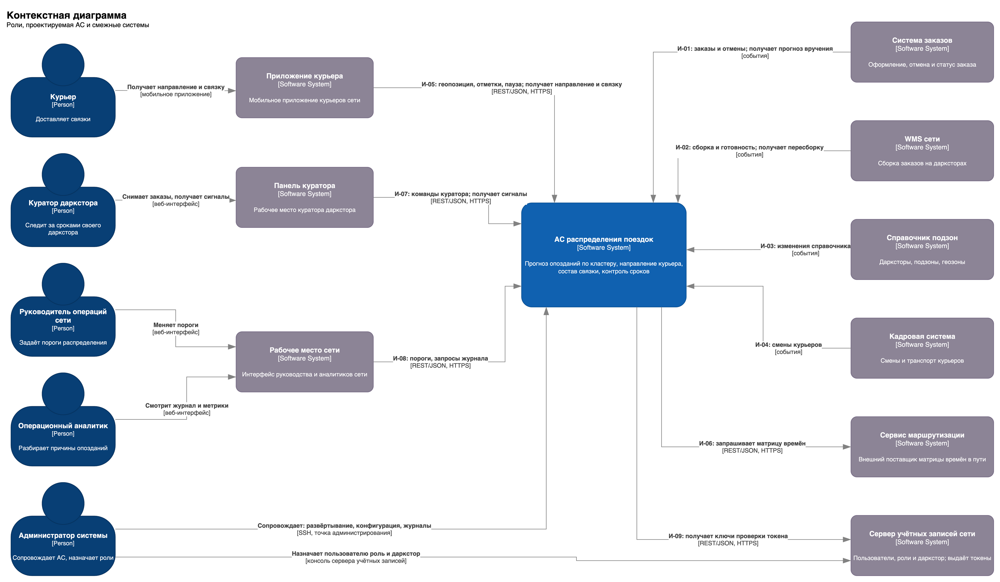
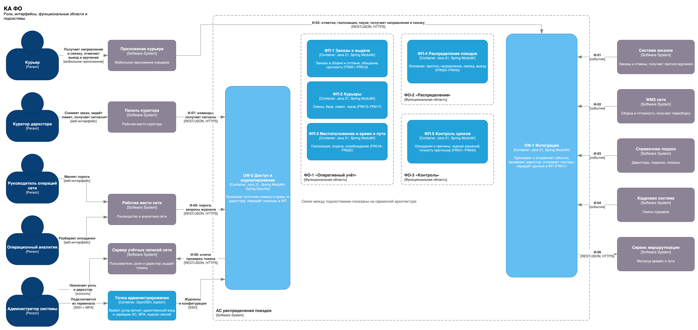
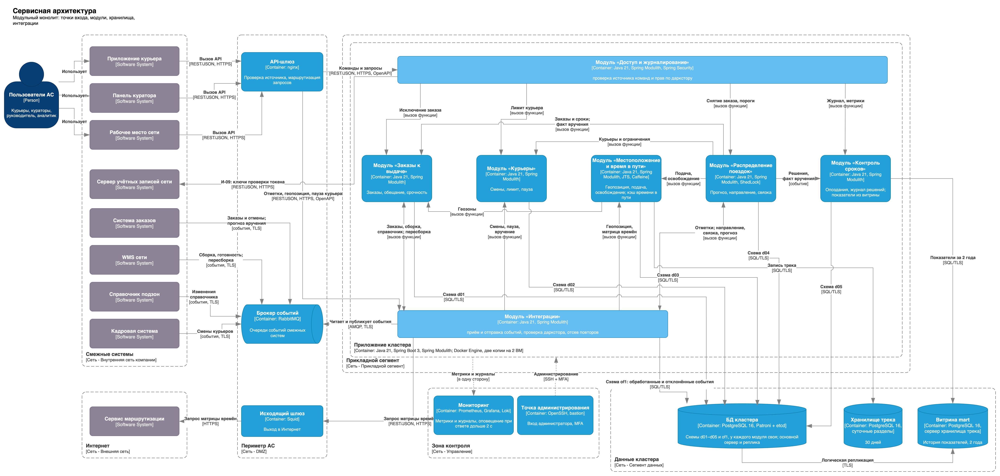
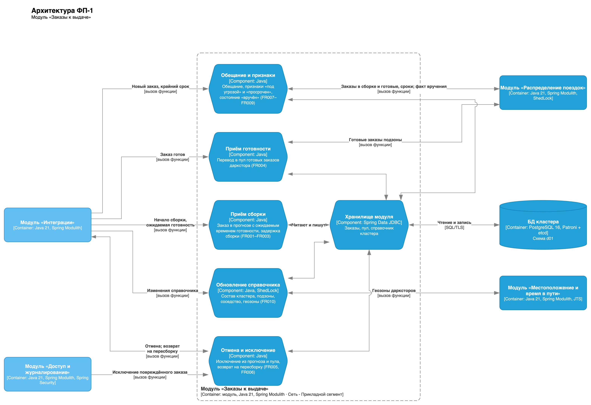
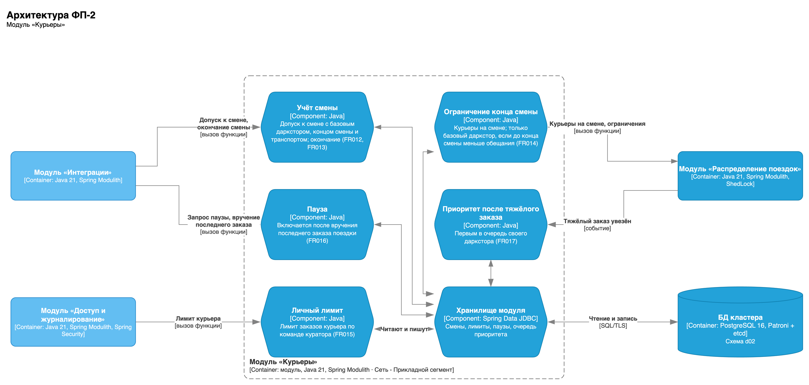
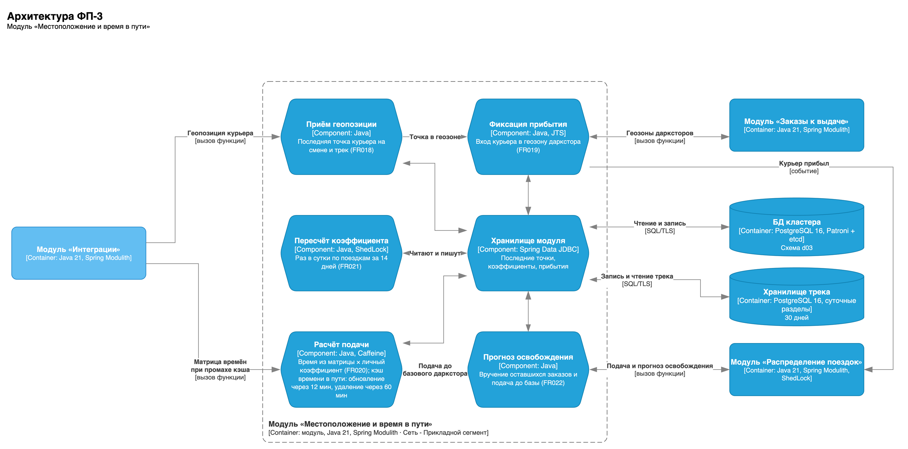
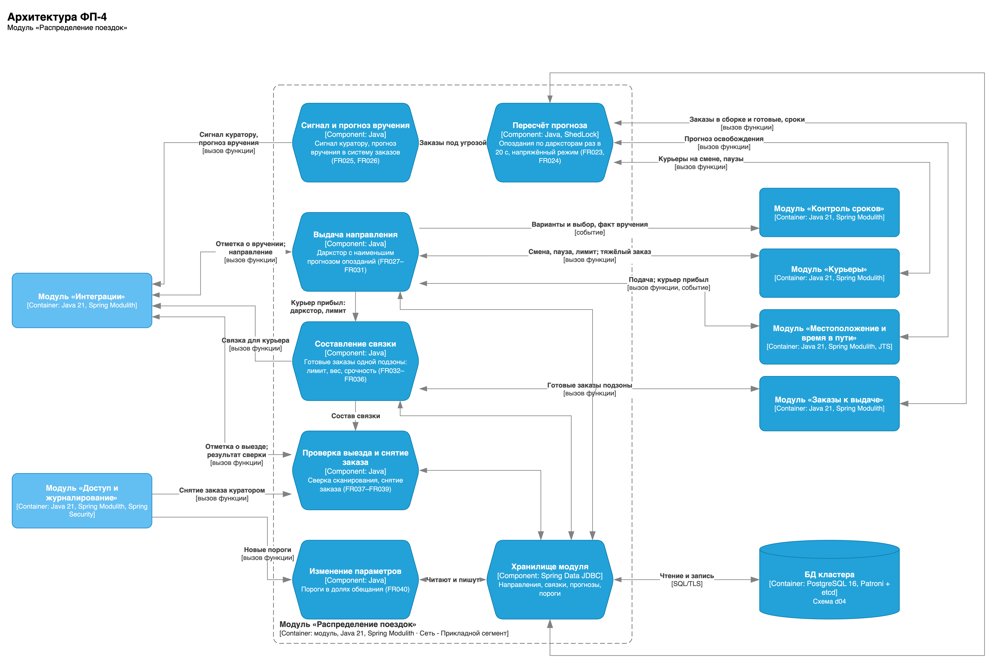
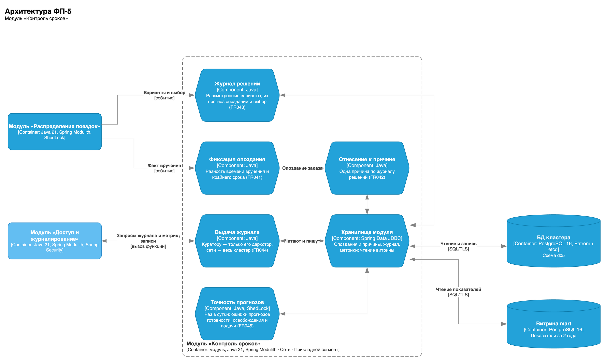
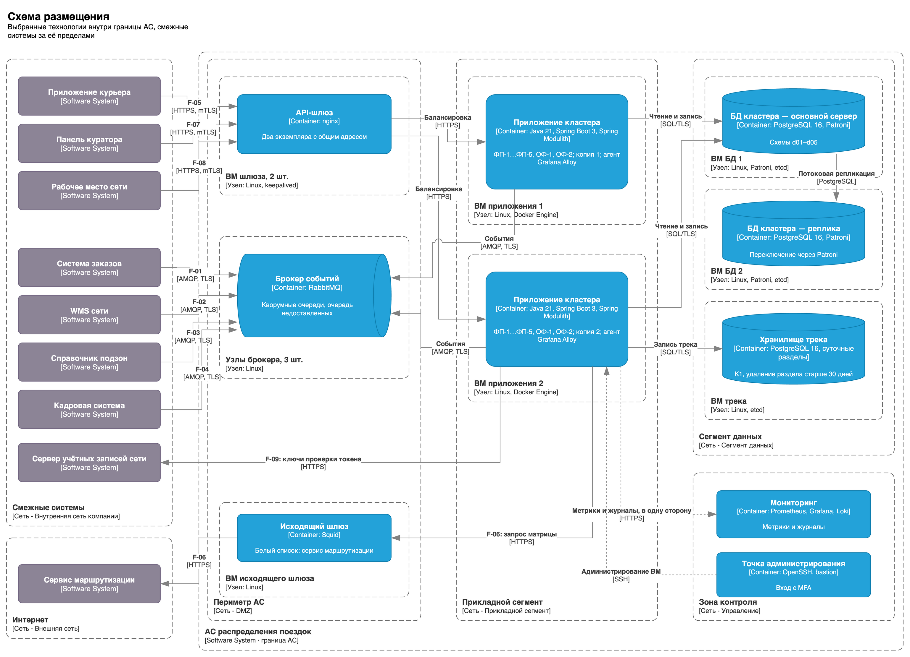
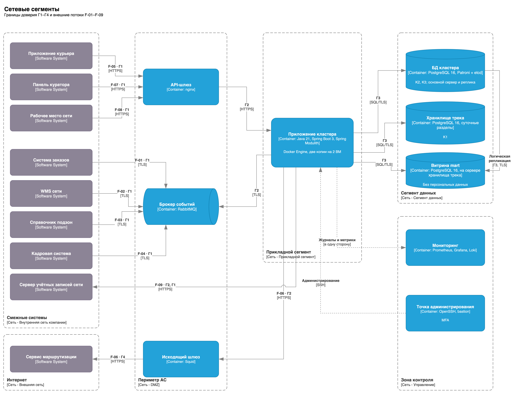

# Архитектура

## Архитектурные драйверы

| Драйвер | Основание | Следствие для архитектуры |
|---|---|---|
| Атомарность связки | FR032, FR037, NFR002 | Включение заказа в связку и изменение его доступности — одна транзакция; распределённая транзакция недопустима |
| Срок решения | NFR001, FR023 | Прогноз читает состояние D01–D03 и пишет D04 за 2 секунды; сетевые вызовы между частями решения добавляют задержку без выигрыша |
| Кластер как единица согласованности | FR027, FR028 | Решение сравнивает дарксторы кластера; нагрузка делится по кластерам, а не по дарксторам или функциям |
| Поток геопозиций | FR018, NFR003 | 100 курьеров раз в 10 секунд — около 10 сообщений в секунду на кластер; при росте сети это первый кандидат на выделение |
| Расширяемость кластера | NFR007 | Состав кластера берётся из справочника, правила от числа дарксторов не зависят |
| Круглосуточная работа | NFR005 | Обновление без остановки обслуживания: не меньше двух копий приложения |
| Защита данных | NFR003, NFR004 | Права по даркстору проверяются на входе, а не в каждом модуле |
| Команда | Допущение проекта | Одна команда из 6–8 человек с единым циклом релизов |

Определяющие — первые три: закрепление заказа за связкой обязано быть атомарным, решение принимается за 2 секунды с доступом к состоянию четырёх доменов, а нагрузка естественно делится по кластерам. Все три говорят в пользу **одной единицы развёртывания на кластер**.

## Почему модульный монолит

| Вариант | Применимость к проекту | Ограничение |
|---|---|---|
| Простой монолит | Не подходит: пять доменов с разными владельцами знаний и разным ритмом изменений; правила распределения и параметры менялись бы одним куском кода | Границы ответственности размываются, проверить единственного владельца данных нельзя |
| Слоистый монолит | Подходит частично: у АС нет собственного интерфейса, поэтому разделение на представление, логику и данные мало что даёт | Слои режут систему поперёк предметных границ |
| Модульный монолит | Подходит: домены D01–D05 выделены, у каждого набора данных один владелец, модули совпадают с доменами | Нужны правила доступа к данным и контроль связности модулей |

Принят модульный монолит: одно приложение на кластер дарксторов в двух копиях, внутри — модули по доменам и два общесистемных модуля. Модуль работает только со своей схемой БД, к чужим данным обращается через операции модуля-владельца; границы проверяются тестом сборки (Spring Modulith, [ADR-003](adr/ADR-003-platform.md)).

| Модуль | Функции | Данные-владелец | Интеграции |
|---|---|---|---|
| Заказы к выдаче (D01) | Приём заказов и сборки, пул, обещание, признаки | Проекция заказа, справочник кластера | И-01, И-02, И-03 |
| Курьеры (D02) | Смены, лимит, пауза, компенсация | Состояние курьера на смене | И-04, И-05, И-07 |
| Местоположение (D03) | Геопозиция, геозоны, подача, прогноз освобождения | Последние точки, коэффициенты | И-03, И-05, И-06 |
| Распределение поездок (D04) | Прогноз, направление, связка, выдача, параметры | Прогноз, направления, связки, параметры | И-05, И-07, И-08 |
| Контроль сроков (D05) | Опоздания, журнал, точность прогнозов | Опоздания, журнал решений | И-07, И-08 |
| Интеграции (ОФ-1) | Приём и отправка событий, проверка даркстора, отсев повторов | Своих предметных данных нет | Все |
| Доступ и журналирование (ОФ-2) | Проверка источника команд и прав по даркстору | Своих предметных данных нет | И-05, И-07, И-08, И-09 |

**Когда выделять сервис.** Первый кандидат — приём геопозиций модуля D03: поток растёт с числом курьеров и не требует общей транзакции со связкой. Выделять его стоит, когда поток геопозиций начнёт влиять на время решения из NFR001. Разделение D01, D02 и D04 не рассматривается: составление связки потребовало бы распределённой транзакции.

## Контекст

## Функциональные области

## Сервисная архитектура (C4, уровень контейнеров)

## Модули

| Модуль | Схема |
|---|---|
| ФП-1 «Заказы к выдаче» |  |
| ФП-2 «Курьеры» |  |
| ФП-3 «Местоположение и время в пути» |  |
| ФП-4 «Распределение поездок» |  |
| ФП-5 «Контроль сроков» |  |

## Технологии

Каждая технология выбрана отдельным решением с критериями и отвергнутыми вариантами — см. [ADR](adr/README.md).

| Слой | Решение | Технология | Основание | ADR |
|---|---|---|---|---|
| Клиент | API внешних интерфейсов | REST/JSON, OpenAPI | И-05, И-07, И-08; D04-S04-NFR004 | ADR-001 |
| Клиент | Доставка направления | Ответ на отметку, уведомление при смене | D04-S02-NFR001; FR030 | ADR-002 |
| Сервер | Платформа модулей | Java 21, Spring Boot 3, Spring Modulith | ДР-9; D04-S04-NFR002 | ADR-003 |
| Сервер | Доступ к агрегатам | Spring Data JDBC | D04-S04-NFR002 | ADR-004 |
| Сервер | Геозоны | JTS | D03-S01-FR019 | ADR-008 |
| Сервер | Периодические задачи | ShedLock | D04-S01-FR023; D04-S01-NFR005 | ADR-010 |
| Данные | Оперативные данные и журнал | PostgreSQL 16 | D04-S04-NFR002; D01-S01-NFR006; D05-S02-NFR008 | ADR-005 |
| Данные | Резервирование | Patroni, etcd | D04-S01-NFR005 | ADR-006 |
| Данные | Трек геопозиций | PostgreSQL 16, суточные разделы | D03-S01-NFR003 | ADR-007 |
| Интеграции | События смежных систем | RabbitMQ, реестр событий Spring Modulith | D01-S01-NFR006 | ADR-009 |
| Интеграции | Входной шлюз | nginx, keepalived | Г1; D04-S01-NFR005 | ADR-011 |
| Интеграции | Права по даркстору | Токены сервера учётных записей сети, Spring Security | D04-S04-NFR004 | ADR-012 |
| Интеграции | Выход в Интернет | Squid | D03-S02-FR020; Г4 | ADR-013 |
| Эксплуатация | Развёртывание | Docker на двух ВМ | D04-S01-NFR005 | ADR-014 |
| Эксплуатация | Наблюдаемость | Prometheus, Grafana, Loki, Grafana Alloy, Micrometer | D04-S02-NFR001 | ADR-015 |

## Размещение и сетевые сегменты

Входной шлюз и брокер работают в периметре: смежные системы подключаются к ним, а приложение само подключается к брокеру, базам данных и исходящему шлюзу, поэтому прикладной сегмент принимает входящие соединения только от API-шлюза и точки администрирования. Метрики и журналы уходят в зону контроля в одну сторону.

### Где находятся данные

| Данные | Хранилище | Сегмент | Класс | Срок хранения |
|---|---|---|---|---|
| Заказы в сборке и готовые, справочник кластера | БД кластера, схема d01 | Данные | K3 | Заказ — до вручения или отмены |
| Смены, лимиты, паузы курьеров | БД кластера, схема d02 | Данные | K2 | Текущая смена |
| Последняя точка курьера, коэффициент скорости | БД кластера, схема d03 | Данные | K1, K2 | Точка — до конца смены |
| Трек смены | Хранилище трека | Данные | K1 | 30 дней |
| Направления, связки, прогнозы, пороги | БД кластера, схема d04 | Данные | K2 | Пока действуют; история — в журнале |
| Опоздания, журнал решений, метрики точности | БД кластера, схема d05 | Данные | K2 | Не менее 90 дней |
| Необработанные события | Очереди брокера | Периметр | K2, K3 | До подтверждения обработки |
| Метрики и журналы работы без координат | Мониторинг | Зона контроля | K2 | По политике сети |
