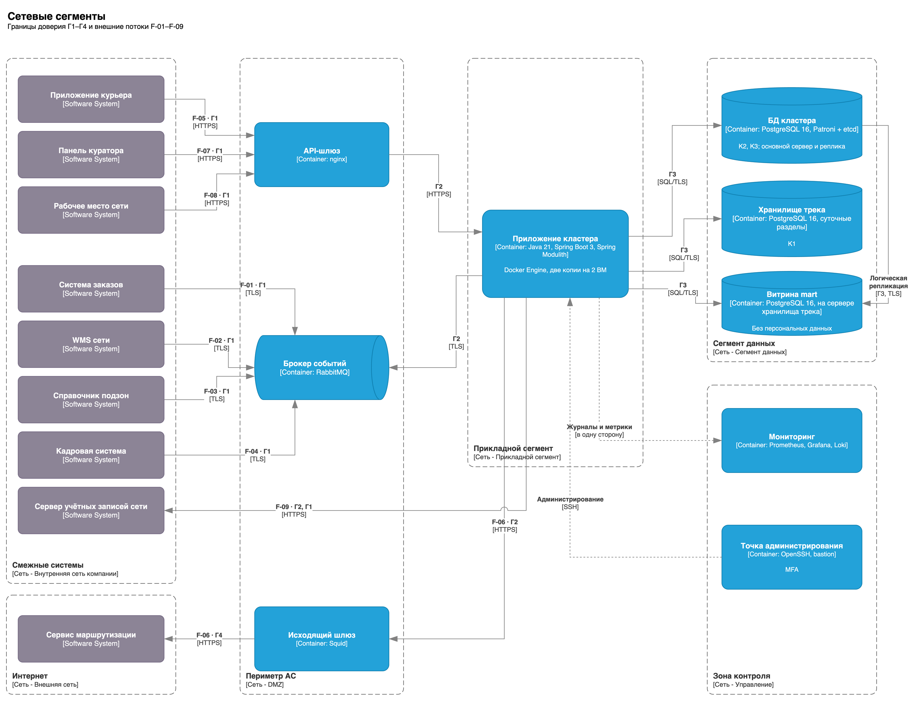

# Доступ и защита данных

## Роли и права

Своего интерфейса у системы нет. Роль и даркстор пользователя хранит сервер учётных записей сети, система проверяет их по подписанному токену (И-09, [ADR-012](adr/ADR-012-darkstore-permissions.md)). Из токена берутся роль и идентификатор, а принадлежность смены, направления и связки проверяется по БД кластера.

- **Базовые права** — чтение и действия только со своими данными.
- **Расширенные права** — изменение данных и параметров в своей зоне ответственности.
- **Права разработчика** — развёртывание, конфигурация и журналы без предметных операций.

| Роль | Интерфейс | Права |
|---|---|---|
| Курьер | Приложение курьера | Базовые права: курьер получает только свои направления и связки (NFR004), не выбирает заказы и не может отказаться от направления; из токена берутся роль и идентификатор курьера, а открытая смена и принадлежность направления проверяются по данным БД кластера. |
| Куратор даркстора | Панель куратора | Расширенные права: изменяет заказы, связки и лимиты курьеров, но только своего даркстора (NFR004); назначить заказ курьеру не может. |
| Руководитель операций сети | Рабочее место сети | Расширенные права: изменяет параметры распределения для всего кластера. |
| Операционный аналитик | Рабочее место сети | Базовые права: только чтение данных всех дарксторов кластера, без изменения данных и настроек. |
| Администратор системы | Точка администрирования: OpenSSH через bastion, двухфакторный вход | Права разработчика: развёртывание, конфигурация и журналы приложения; предметных операций с заказами, курьерами и направлениями не выполняет. |

## Классы данных

Класс присваивается конкретным данным, а не системе целиком. Адрес и состав заказа в систему не поступают — курьер получает их из системы заказов напрямую. Это сознательная минимизация.

| Класс | Критерий | Данные проекта |
|---|---|---|
| K1 | Высокий ущерб при компрометации | Геопозиция курьера, привязанная к его идентификатору |
| K2 | Средний ущерб | Идентификатор курьера и его смены, направления и связки, команды кураторов, журнал решений, параметры распределения |
| K3 | Низкий ущерб | Справочник подзон, матрица времён, данные заказа без клиента: номер, подзона, вес, сроки; агрегированные метрики |

## Сетевые сегменты

| Сегмент | Причина выделения | Политика доступа |
|---|---|---|
| Сегмент смежных систем | Системы других владельцев | К АС обращаются только через API-шлюз и брокер событий |
| Периметр АС | Единственное место пересечения внешней границы | Принимает соединения только от разрешённых систем; выход в Интернет — только через исходящий шлюз |
| Прикладной сегмент | Здесь принимаются решения | Принимает соединения только от API-шлюза и точки администрирования; к брокеру, базам данных, серверу учётных записей и исходящему шлюзу подключается сам |
| Сегмент данных | Хранит данные кластера и трек класса K1 | Принимает соединения только от учётных записей приложения; соединений не инициирует |
| Зона контроля | Журналы и администрирование | Журналы принимаются в одну сторону; администрирование через многофакторную аутентификацию; не является промежуточным узлом потоков данных |

## Внешние потоки

| F-ID | Интеграция и требования | Отправитель ↔ получатель | Данные | Класс |
|---|---|---|---|---|
| F-01 | И-01; FR005, FR007, FR026 | Система заказов ↔ АС | Номер, даркстор, подзона, сроки, отмена; прогноз вручения | K3 |
| F-02 | И-02; FR001–FR004, FR006 | WMS ↔ АС | Номер, время готовности, готовность, вес; пересборка | K3 |
| F-03 | И-03; FR010, FR019 | Справочник подзон → АС | Дарксторы, подзоны, геозоны | K3 |
| F-04 | И-04; FR012–FR014 | Кадровая система → АС | Идентификатор курьера, база, конец смены, транспорт | K2 |
| F-05 | И-05; FR018, FR027, FR032, FR037 | Приложение курьера ↔ АС | Геопозиция с идентификатором; отметки; направление, связка | K1 |
| F-06 | И-06; FR020 | АС → сервис маршрутизации | Точки сетки и дарксторов; матрица времён | K3 |
| F-07 | И-07; FR015, FR025, FR038 | Панель куратора ↔ АС | Команды, сигналы, журнал даркстора | K2 |
| F-08 | И-08; FR040, FR042–FR045 | Рабочее место сети ↔ АС | Параметры, метрики, журнал кластера | K2 |
| F-09 | И-09; NFR004, FR044 | АС → сервер учётных записей сети | Открытые ключи проверки подписи токенов; в токене — идентификатор, роль, даркстор | K2 |

| F-ID | Маршрут | Защита | Контроль |
|---|---|---|---|
| F-01 – F-04 | Смежные системы → брокер (Г1); модуль интеграций читает брокер из прикладного сегмента (Г2); TLS | Взаимная аутентификация систем; проверка даркстора кластера; отсев повторов | Журнал приёма; отклонённые события с причиной |
| F-05 | Приложение курьера → API-шлюз (Г1) → прикладной сегмент (Г2); HTTPS | Взаимная аутентификация; курьер передаёт только свою геопозицию и получает только свою связку; трек шифруется при хранении; точки только на смене | Журнал доступа к треку; ночное удаление трека старше 30 дней |
| F-06 | Прикладной сегмент → исходящий шлюз (Г2) → Интернет (Г4); HTTPS | Проверка сертификата сервиса; в запросе нет идентификаторов курьеров | Журнал запросов; при отказе — последняя матрица |
| F-07, F-08 | Панель куратора, рабочее место → API-шлюз (Г1) → прикладной сегмент (Г2); HTTPS | Взаимная аутентификация систем; права куратора — только свой даркстор; параметры меняет только руководитель операций | Журнал команд и изменений параметров |
| F-09 | Прикладной сегмент (Г2) → сегмент смежных систем (Г1); HTTPS | Проверка сертификата сервера; в АС поступают только открытые ключи, пароли не передаются; роль и даркстор берутся только из подписанного токена | Журнал отказов проверки токена; при недоступности — сохранённые ключи |

## Угрозы на границах доверия (Г1–Г4)

| Граница | Угрозы и меры | Проверка |
|---|---|---|
| Г1: смежные системы — периметр | Отказ: брокер хранит события до восстановления. Доступ и подмена: только разрешённые системы с сертификатом, проверка даркстора; пользователь — только по подписанному токену. Раскрытие: TLS | Подключение без сертификата отклонено; событие чужого даркстора отклонено |
| Г2: периметр — прикладной сегмент | Отказ: две копии приложения. Доступ: входящие соединения только от шлюза, к брокеру приложение подключается само. Подмена прав: проверка даркстора на входе | Прямой запрос к приложению в обход шлюза отклонён |
| Г3: прикладной сегмент — данные | Доступ: у модуля своя учётная запись и схема. Раскрытие: шифрование трека. Отказ: резервное копирование | Модуль не читает чужую схему |
| Г4: исходящий шлюз — Интернет | Раскрытие: передаются только точки сетки. Подмена: проверка сертификата. Отказ: работа на последней матрице | В запросе нет идентификаторов курьеров |
