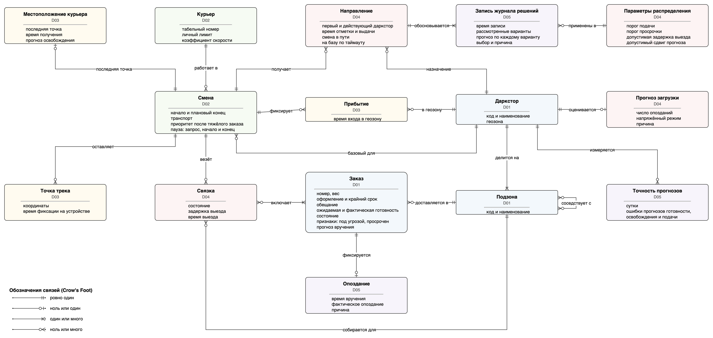
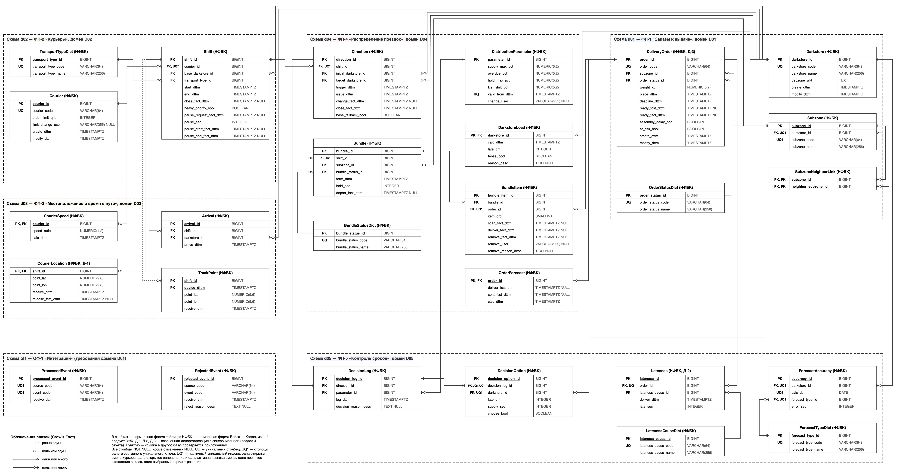

# Модель данных

27 таблиц в схемах `d01`–`d05` (по схеме на модуль) и `of1` (обработанные и отклонённые события), плюс хранилище трека в отдельной базе. Все таблицы — в **НФБК**; три осознанные денормализации обоснованы требованиями и замером.

Всё ниже проверено на [стенде](../db/README.md): PostgreSQL 17, данные за 90 дней — 405 тыс. заказов, 430 тыс. вхождений в связки, 196 тыс. направлений, 12,9 млн точек трека. Время запроса — медиана семи прогонов `EXPLAIN ANALYZE` после прогрева.

## Концептуальная модель

## Логическая модель (целевая, v2)

Ключевые правила держит сама база:

- частичный уникальный индекс не даёт заказу попасть в две действующие связки, а смене — иметь два направления (NFR002);
- `CHECK` не даёт разойтись состоянию и фактам (связка без выезда, назначение без смены в пути);
- `UNIQUE (source_code, event_code)` отсеивает повторные события (NFR006).

## Функциональные зависимости и аномалии исходной схемы (v1)

| № | Таблица и зависимость | Аномалия | Нарушение | Решение |
|---|---|---|---|---|
| А-1 | DeliveryOrder: place_dttm, deadline_dttm → promise_sec | Обновление: срок изменён, обещание — нет; противоречие ловит только CHECK, и операция падает | 3НФ: транзитивная зависимость от неключевых атрибутов | Столбец удалён, обещание вычисляется (Ц-1) |
| А-2 | DeliveryOrder: deadline_dttm, состояние и текущее время → overdue_bool | Обновление: признак ставит таймер; пропущенный цикл — просроченный заказ без признака (FR009) | Не нарушение НФ: выводимый атрибут | Столбец удалён, признак вычисляется в запросе (Ц-1) |
| А-3 | DeliveryOrder и BundleItem: факт вручения есть только в BundleItem, заказ остаётся READY | Выборка и обновление: вручённый заказ выглядит готовым; чтобы найти действующие заказы, нужен поиск по BundleItem (Q1 — 47,6 мс полным просмотром) | Не нарушение НФ: неполный набор состояний | Состояние DELIVERED (Ц-2); копия факта вручения в заказе — Д-3 (раздел 4) |
| А-4 | SubzoneNeighborLink: пара {A, B} хранится строками (A, B) и (B, A) | Вставка: можно записать одну половину пары; удаление: после удаления одной строки соседство несимметрично | Избыточность при формально выполненной НФБК | Пара хранится один раз (Ц-3) |
| А-5 | ForecastAccuracy: (darkstore_id, calc_dt) → ready_error_sec, release_error_sec, supply_error_sec | Вставка: ошибку одного прогноза нельзя записать, пока не рассчитаны остальные; новый вид прогноза требует изменения структуры | Не нарушение НФ: каждый столбец атомарен, но три однотипных столбца мешают добавить вид прогноза | Декомпозиция как проектное решение (Ц-4) |
| А-6 | DecisionOption: decision_log_id → log_dttm; копия нужна, потому что ключ раздельной DecisionLog обязан включать ключ раздела | Обновление: время записи хранится в двух таблицах | 2НФ: зависимость от части возможного ключа (decision_log_id, darkstore_id), заданного UNIQUE | Разделы журнала сняты, копия удалена (Ц-5) |
| А-7 | TrackPoint: (shift_id, время точки на устройстве) → point_lat, point_lon при суррогатном ключе track_point_id; времени устройства в схеме нет | Вставка: точка, отправленная телефоном повторно, записывается второй раз. Ключ по времени приёма не помогает: у повтора другое время приёма, а пакет точек, вставленный одной транзакцией, получает одинаковое | Не нарушение НФ: естественный ключ не объявлен | Время устройства device_dttm, первичный ключ (shift_id, device_dttm) (Ц-6) |
| А-8 | Bundle: bundle_status_id и depart_fact_dttm: выезда нет тогда и только тогда, когда связка FORMED или DISBANDED | Обновление: состояние и факт выезда могут разойтись | Не нарушение НФ: зависимость между атрибутами | CHECK (Ц-7) |
| А-9 | Direction: если change_fact_dttm пусто, то target_darkstore_id = initial_darkstore_id | Обновление: назначение отличается от выданного без смены в пути | Не нарушение НФ: зависимость между атрибутами | CHECK (Ц-7) |
| А-10 | Lateness: order_id → deliver_dttm (копия факта вручения); deliver_dttm и крайний срок → late_sec | Не возникает: после вручения оба источника не меняются | Избыточность между таблицами | Оставлено как Д-2 (раздел 4) |
| А-11 | CourierLocation: shift_id → последняя точка, она же последняя строка TrackPoint | Обновление: при сбое записи трека последняя точка и трек расходятся | Избыточность между базами | Оставлено как Д-1 (раздел 4) |
| А-12 | DeliveryOrder: order_id → at_risk_bool; признак рассчитывается из прогноза вручения ФП-4 | Признак отстаёт от прогноза не больше чем на цикл пересчёта (20 с) | Внутри таблицы нарушения нет | Оставлено: признак ведёт ФП-1 по FR008, а прогноз принадлежит ФП-4, чужую схему модуль не читает |

## Декомпозиции

| Изменение | Вызвавшая зависимость | Восстановление данных | Сохранение зависимостей и целостности |
|---|---|---|---|
| ForecastAccuracy → ForecastAccuracy + ForecastTypeDict | (darkstore_id, calc_dt) → три ошибки, заменена на (darkstore_id, calc_dt, forecast_type_id) → error_sec | Строка v1 собирается из трёх строк по (darkstore_id, calc_dt) | UNIQUE (darkstore_id, calc_dt, forecast_type_id); внешний ключ на справочник; три строки за сутки ФП-5 пишет одной транзакцией |
| DecisionOption без log_dttm | decision_log_id → log_dttm | Время записи получается соединением с DecisionLog по decision_log_id | Внешний ключ decision_log_id → DecisionLog; время хранится в одном месте |
| DeliveryOrder без promise_sec и overdue_bool | place_dttm, deadline_dttm → promise_sec; срок, состояние и время → признак «просрочен» | Обещание — deadline_dttm − place_dttm; признак — состояние действующее и deadline_dttm < now() | CHECK (deadline_dttm > place_dttm); значения выводятся из хранимых, поэтому разойтись не могут |

## Денормализация

| Решение | Измерение на стенде | Вывод | Синхронизация |
|---|---|---|---|
| Д-1. CourierLocation — последняя точка смены в базе кластера, копия последней строки TrackPoint | Открытые смены даркстора с точками (Q5) — 0,55 мс. Последние точки 100 смен из трека: 3 223 мс на ключе v1, 0,37 мс на новом ключе | После смены ключа трека скорость перестала быть основанием. Копия нужна по двум причинам: FR018 требует хранить последнюю точку, а трек лежит в другой базе на отдельной ВМ. Без копии ФП-4 не может соединить смены с точками в одном запросе, а отказ базы трека остановил бы выдачу направлений | ФП-3 на каждую геопозицию сначала обновляет CourierLocation (UPSERT по shift_id), затем пишет точку в трек; неудачная запись трека повторяется. Источник истины о текущем положении — CourierLocation. Метрика — число открытых смен, у которых трек отстаёт больше чем на минуту |
| Д-2. Lateness хранит время вручения и опоздание | Отчёт опозданий по причинам за неделю (Q7): 18,1 мс по Lateness, 42,9 мс при расчёте из BundleItem и DeliveryOrder | Главное основание — опоздание является историческим фактом: оно фиксируется в момент вручения и не должно меняться, если позже исправят крайний срок заказа, причину или пороги. Кроме того, расчёту без копии нужны таблицы схем d01 и d04, а ФП-5 их не читает. Выигрыш по времени — побочный эффект: отчёт строится несколько раз в сутки | Запись создаётся один раз обработчиком события «факт вручения»; срок передаётся в событии. Доставку события гарантирует реестр событий Spring Modulith. Раз в сутки число записей Lateness сверяется с числом вручений по данным ФП-4, недостающие события публикуются повторно |
| Д-3. Состояние DELIVERED в DeliveryOrder — копия факта вручения из BundleItem | Действующие заказы даркстора (Q1): 47,6 мс с поиском вручения в BundleItem, 0,12 мс по состоянию заказа и частичному индексу I-1 | Состояние заказа принадлежит ФП-1, а факт вручения — ФП-4, и модуль не читает чужую схему. Без копии невозможен частичный индекс I-1: его условие может ссылаться только на свою таблицу | ФП-4 при отметке вручения вызывает ФП-1 в той же транзакции: факт в BundleItem и состояние заказа фиксируются вместе или не фиксируются вовсе. Сверка «вручено, но не DELIVERED» после миграции дала 0 строк |

## Типовые запросы

| № | Запрос | Требование | Частота |
|---|---|---|---|
| Q1 | Действующие заказы даркстора для прогноза и пула | FR004, FR023 | Не реже раза в 20 с на даркстор и на каждое событие |
| Q2 | Просроченные невручённые заказы даркстора | FR009 | Раз в минуту на панель куратора |
| Q3 | Состав связки в порядке срочности | FR031, FR032, FR037 | На каждое составление, сканирование и вручение |
| Q4 | Очередь курьеров, прибывших на даркстор за час | FR017, FR032 | На каждое составление связки |
| Q5 | Открытые смены даркстора с последними точками | FR020, FR022, FR023 | Раз в 20 с на даркстор |
| Q6 | Журнал решений даркстора за сутки | FR044, NFR004 | По запросу куратора |
| Q7 | Опоздания по причинам за неделю | FR041, FR042 | По запросу аналитика, несколько раз в сутки |
| Q8 | Трек смен курьера за 14 дней | FR021 | Раз в сутки на каждого из 120 курьеров |
| Q9 | Проверка повторного события | NFR006 | На каждое входящее событие |
| Q10 | Удаление заказов старше 90 дней | Срок хранения из модели данных v1 | Раз в сутки, 4 500 заказов |
| Q11 | Удаление записей журнала старше 90 дней | NFR008 | Раз в сутки, около 2 200 записей |

## Индексы

Порядок полей подчиняется одному правилу: сначала поле, которое сравнивается на равенство, затем поле диапазона или сортировки.

| Индекс | Поля и условие | Запрос | Обоснование | До, мс | После, мс |
|---|---|---|---|---|---|
| I-1 deliveryorder_active_ix | DeliveryOrder (subzone_id, deadline_dttm) WHERE состояние ASSEMBLING, READY или REASSEMBLY | Q1, Q2 | Частичный индекс: из 405 тыс. заказов действуют около 600, размер 64 КБ. Подзона — равенство, срок — диапазон для Q2 | 47,6; 14,5 | 0,12; 0,02 |
| I-2 bundleitem_bundle_ix | BundleItem (bundle_id, item_ord) | Q3 | Строки сразу в порядке срочности, без сортировки; служит и проверке ключа при удалении связок | 9,3 | 0,003 |
| I-3 bundleitem_order_ix | BundleItem (order_id) | Q10, FR005 | Частичный уникальный индекс v1 содержит только неснятые вхождения и не подходит для проверки внешнего ключа | 58 709 | 83 |
| I-4 arrival_darkstore_ix | Arrival (darkstore_id, arrive_dttm) | Q4 | Даркстор — равенство, время — диапазон и порядок очереди | 5,9 | 0,008 |
| I-5 direction_target_ix | Direction (target_darkstore_id, issue_dttm) | Q6 | Куратор видит только свой даркстор, затем период | 16,2 | 1,3 |
| I-6 decisionlog_direction_ix | DecisionLog (direction_id) | Q6 | Соединение направления с журналом; проверка ключа при удалении направлений |  |  |
| I-7 decisionlog_log_ix | DecisionLog (log_dttm) | Q11 | Заменяет помесячные разделы при удалении по сроку | — | 12 |
| I-8 первичный ключ TrackPoint | TrackPoint (shift_id, device_dttm) в каждом разделе | Q8, А-7 | Трек смены читается по смене и времени; заодно отклоняет повторную точку | 121,4 | 15,6 |

Чего **не** индексируем и почему:

- внешние ключи на справочники и маленькие таблицы (2–30 строк, родители не удаляются);
- внешние ключи на `Shift`: проверка одной смены полным просмотром ~5 мс, за ночь удаляется 100 смен — ~1,5 с;
- `Lateness (deliver_dttm)`: ускоряет отчёт с 18,1 до 7,2 мс при размере 8,6 МБ, а отчёт строится несколько раз в сутки;
- у трека только первичный ключ: ~10 вставок в секунду, каждый лишний индекс удорожает запись.

## v1 → v2

| Элемент | модели данных v1 | модели данных v2 |
|---|---|---|
| Таблицы | 26: 25 в базе кластера и TrackPoint в базе трека | 27: добавлен ForecastTypeDict |
| DeliveryOrder | 15 атрибутов, в том числе promise_sec и overdue_bool | 13 атрибутов, обещание и просрочка вычисляются |
| Состояния заказа | ASSEMBLING, READY, CANCELLED, REASSEMBLY | Добавлено DELIVERED |
| SubzoneNeighborLink | Две строки на пару | Одна строка на пару |
| ForecastAccuracy | Столбец на вид прогноза | Строка на вид прогноза |
| DecisionLog | Помесячные разделы, ключ (decision_log_id, log_dttm) | Без разделов, ключ decision_log_id |
| DecisionOption | Копия log_dttm в составном внешнем ключе | Внешний ключ по decision_log_id |
| TrackPoint | Ключ track_point_id | Ключ (shift_id, device_dttm), разделы по времени устройства |
| Ограничения CHECK | По таблица модели данных v1 | Добавлены три: готовность, выезд связки, назначение |
| Вторичные индексы | Только ограничения уникальности | Семь индексов, около 43 МБ в базе кластера |
| Самый частый запрос Q1 | 47,6 мс | 0,12 мс |
| Удаление заказов за сутки | 58,7 с | 83 мс |

## План миграции

Миграция — скриптами при запуске новой версии ночью; события смежных систем в это время копятся в RabbitMQ. Простой — около минуты.

| Шаг | Действие | Проверка целостности | Откат | Время на стенде |
|---|---|---|---|---|
| 0 | Резервная копия базы; контрольные суммы и число строк изменяемых таблиц | Сохранённые значения — эталон для шагов 1–8 | — | — |
| 1 | Состояние DELIVERED: перевод вручённых заказов; CHECK готовности (NOT VALID, затем VALIDATE) | Нет вручённых заказов в другом состоянии; ограничение подтверждено | Вернуть READY, удалить код | 2,6 с |
| 2 | Индексы I-1…I-5 (CREATE INDEX CONCURRENTLY) | Все индексы действительны (indisvalid) | DROP INDEX CONCURRENTLY | 0,6 с |
| 3 | Соседство подзон: удаление обратных пар, новый CHECK | Пар вдвое меньше строк v1, контрольная сумма симметричного набора совпадает | Вставить обратные пары | менее 0,1 с |
| 4 | Новая ForecastAccuracy и справочник, перенос с разворотом строк | Строк втрое больше; свёрнутые обратно данные совпадают с эталоном | Свернуть обратно; суррогатный accuracy_id выдаётся заново, ссылок на него нет | менее 0,1 с |
| 5 | DecisionLog без разделов, индексы I-6, I-7, новый внешний ключ DecisionOption | Число строк и контрольные суммы журнала и вариантов совпадают | Пересоздать разделы, заполнить log_dttm соединением | 1,4 с |
| 6 | CHECK для Bundle и Direction (NOT VALID, затем VALIDATE) | Неподтверждённых ограничений нет | DROP CONSTRAINT | 0,2 с |
| 7 | Сжатие после недели наблюдения: удаление promise_sec, overdue_bool, log_dttm и старых таблиц | Перед удалением — сверка с вычисленными значениями | Столбцы восстанавливаются расчётом, так как выводимы | 0,1 с |
| 8 | База трека: новая таблица с ключом (shift_id, device_dttm) и разделами по времени устройства, перенос точек без повторов (для старых точек время устройства равно времени приёма), удаление старой | Число строк и контрольная сумма совпадают; пакет точек вставляется, повтор точки отклоняется | Обратный перенос в таблицу v1; номера точек выдаются заново | 27 с; откат 29 с |

План проверен полностью: прямая миграция, сверка, откат и повторная миграция. Контрольные суммы пяти изменяемых таблиц совпали во всех трёх состояниях. Стенд показал неочевидное: шаг 1 должен идти **раньше** индексов — иначе после перевода 391 тыс. заказов в `DELIVERED` частичный индекс I-1 разрастается с 64 КБ до 12 МБ мёртвых записей.
