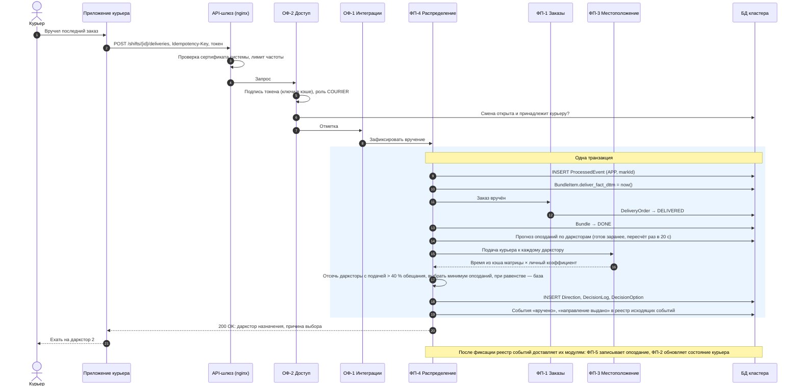
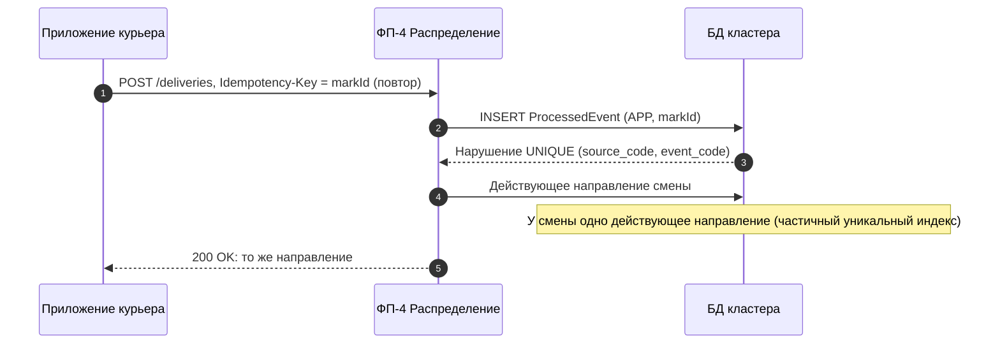
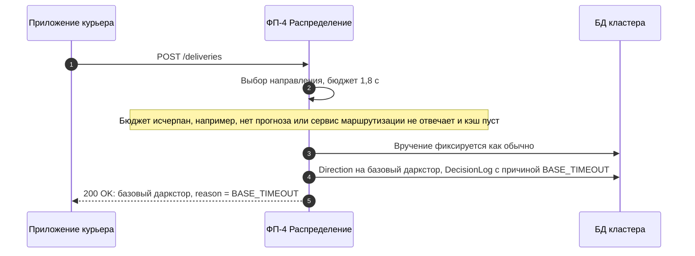
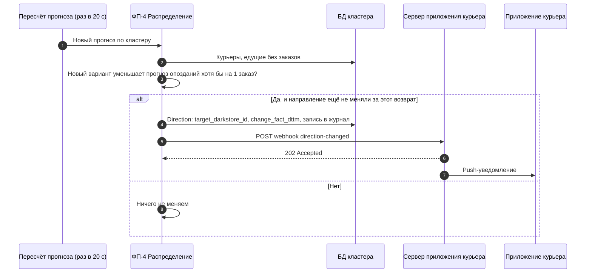
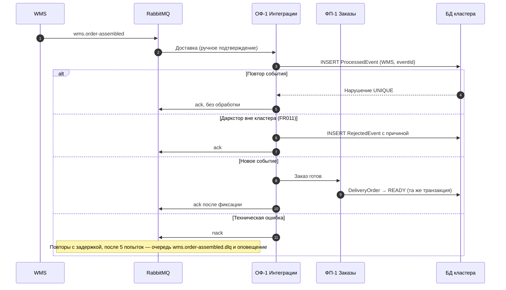

# Сквозной сценарий: выдача направления (FR027)

Через этот сценарий проходят все ключевые решения: курьер отмечает вручение последнего заказа поездки и в ответе получает даркстор, на который ему ехать. Ограничение — **2 секунды** от получения отметки до ответа (NFR001), заказ не может потеряться или оказаться в двух связках (NFR002), повтор отметки не создаёт второго направления (NFR006).

Контракт вызова — `POST /shifts/{shiftId}/deliveries` в [openapi.yaml](api/openapi.yaml).

## 1. Основной поток

Почему так:

- **Прогноз считается заранее.** Пересчёт по кластеру (600 заказов, 100 курьеров) выполняет одна копия приложения раз в 20 с ([ADR-010](adr/ADR-010-scheduled-jobs.md)). В ответе на отметку остаются сравнение не более трёх вариантов и одна транзакция. Вся работа с БД при выдаче направления на стенде — **1,35 мс по p95** при 10 одновременных курьерах ([замер](../db/README.md)).
- **Направление — в синхронном ответе** на ту же отметку, без отдельного уведомления и постоянных соединений со всеми курьерами ([ADR-002](adr/ADR-002-direction-delivery.md)).
- **Вручение и перевод заказа в DELIVERED — одна транзакция**, хотя данными владеют разные модули: иначе заказ мог бы оказаться вручённым в связке, но «готовым» в пуле.
- **События для других модулей сохраняются в той же транзакции** (outbox, реестр Spring Modulith) и досылаются после сбоя ([ADR-003](adr/ADR-003-platform.md)).

## 2. Повтор отметки

Связь оборвалась после того, как система выдала направление, и приложение повторило запрос с тем же ключом.

Тот же ключ с другим телом запроса (другой заказ) — `409 Conflict`: это ошибка клиента, а не повтор.

## 3. Расчёт не уложился в 2 секунды (FR029)

Курьер никогда не ждёт: худший исход — поездка на свой даркстор, как было до появления кластера. Доля таких направлений — метрика М-5 [витрины](08-analytics-mart.md); рост М-5 — сигнал разбираться.

## 4. Смена направления в пути (FR030)

Ограничение «не больше одной смены за возврат» защищает курьера от разворотов каждые 20 секунд. Если сервер приложения не принял уведомление, ФП-4 повторяет отправку с экспоненциальной задержкой; после трёх неудач смена отменяется и курьер продолжает ехать по исходному направлению.

## 5. Событие смежной системы через брокер

Подтверждение отправляется **после** фиксации транзакции: если приложение упадёт между ними, брокер доставит событие повторно, а таблица обработанных событий отсеет повтор. Получается обработка «ровно один раз» поверх доставки «хотя бы один раз». Контракты событий — [asyncapi.yaml](api/asyncapi.yaml).
