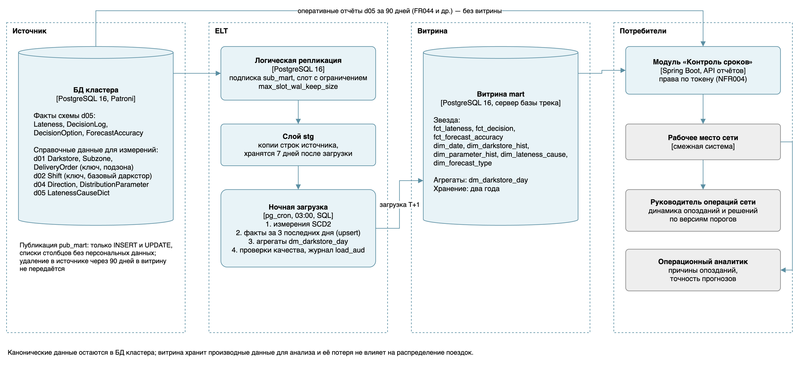
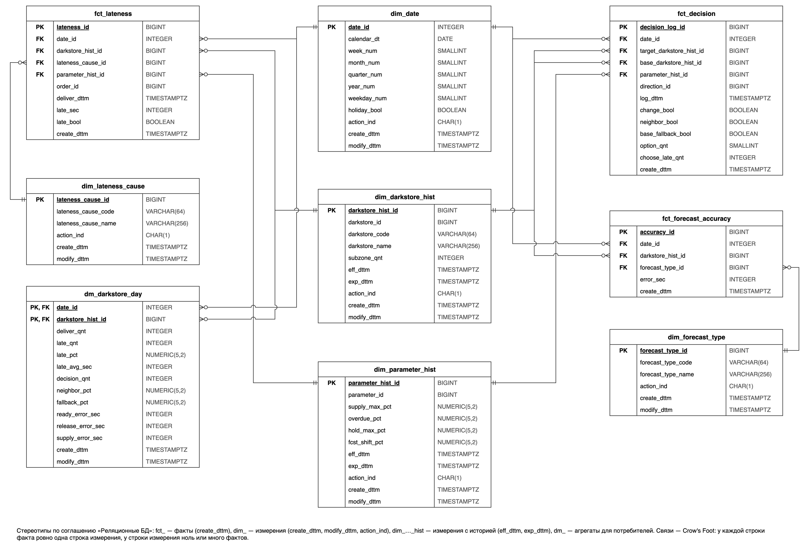

# Витрина данных

Оперативные данные живут 90 дней, а руководителю операций нужна динамика за кварталы. Решение о технологии — [ADR-016](adr/ADR-016-analytics-mart.md).

## Кому и зачем

| Потребитель | Вопросы | Метрики | Гранулярность | Горизонт | Допустимая задержка |
|---|---|---|---|---|---|
| Руководитель операций сети | Помогли ли изменения порогов распределения и состава кластера? Сколько направлений уходит на соседний даркстор и на базу по таймауту? | М-1, М-2, М-4, М-5 | Даркстор × сутки × версия порогов; сводка до недели, месяца, квартала | Два года | Сутки: данные за вчера к 06:00 |
| Операционный аналитик | Где и почему опаздывают заказы? Насколько точны прогнозы готовности, освобождения и подачи? | М-1, М-2, М-3, М-6 | Вручённый заказ для разбора; даркстор × сутки × причина или вид прогноза | Два года | Сутки: данные за вчера к 06:00 |

Куратор даркстора — не потребитель витрины: журнал решений и сигналы нужны ему сразу после события, он получает их из операционной БД.

## Поток данных

Логическая репликация передаёт вставки и изменения таблиц фактов схемы `d05` в слой `stg` за секунды. Удаления не публикуются, поэтому очистка источника через 90 дней не стирает историю. Раз в сутки в 03:00 задача `pg_cron` одной транзакцией обновляет измерения, вставляет факты за три последних дня (окно покрывает опоздавшие события, upsert делает загрузку идемпотентной), пересчитывает агрегаты, проверяет качество и пишет результат в журнал `load_aud`. Данные за вчера готовы к 06:00.

## Модель: звезда

| Таблица | Одна строка — это | Ключ | Источник | Историчность |
|---|---|---|---|---|
| fct_lateness | Вручённый заказ: опоздание и причина | lateness_id — бизнес-ключ источника | Lateness, DeliveryOrder, Subzone | Строки не меняются, хранятся два года |
| fct_decision | Запись журнала решений: выдача или смена направления | decision_log_id — бизнес-ключ | DecisionLog, DecisionOption, Direction, Shift | Строки не меняются, хранятся два года |
| fct_forecast_accuracy | Средняя ошибка вида прогноза по даркстору за сутки | accuracy_id — бизнес-ключ | ForecastAccuracy | Строки не меняются, хранятся два года |
| dim_darkstore_hist | Версия даркстора: название и число подзон | darkstore_hist_id — суррогатный; darkstore_id — бизнес-ключ | Darkstore, Subzone | SCD2: при изменении закрывается версия (exp_dttm) и открывается новая (eff_dttm) |
| dim_parameter_hist | Версия порогов распределения | parameter_hist_id — суррогатный; parameter_id — бизнес-ключ | DistributionParameter | SCD2: eff_dttm — начало действия версии, exp_dttm — начало следующей |
| dim_date | Календарный день | date_id в виде ГГГГММДД | Генерируется на два года вперёд | Не меняется; праздники вносятся вручную |
| dim_lateness_cause, dim_forecast_type | Причина опоздания, вид прогноза | Ключ справочника источника | LatenessCauseDict; виды прогноза модели данных v2 | Перезапись, action_ind = U |
| dm_darkstore_day | Даркстор за сутки: все показатели | date_id и darkstore_hist_id | Факты витрины | Пересчитывается за три последних дня при каждой загрузке |

Факт связывается с версией измерения, действовавшей в момент события, поэтому показатели можно сравнивать **до и после изменения порогов** — это главный вопрос руководителя операций. Интервалы версий одного даркстора не пересекаются (`EXCLUDE` по диапазону).

## Контроль качества

Проверки выполняются в той же транзакции, что и загрузка: если проверка не пройдена, транзакция откатывается и потребители видят данные предыдущей загрузки.

| Проверка | Правило | При нарушении |
|---|---|---|
| Полнота | Число строк fct_lateness и fct_decision за сутки равно числу строк Lateness и DecisionLog в stg за те же сутки | Ошибка, откат |
| Ссылки на измерения | Доля фактов со ссылкой на «неизвестно» не больше 0,5 % | До 0,5 % — предупреждение, больше — ошибка |
| Согласованность | late_bool = (late_sec > 0); причина ON_TIME тогда и только тогда, когда late_sec ≤ 0 (правило модели данных v1) | Ошибка, откат |
| Сверка с источником | Доля опозданий за вчера в dm_darkstore_day совпадает с оперативным отчётом модуля «Контроль сроков» | Ошибка, откат |
| Свежесть | К 06:00 в dm_darkstore_day есть данные за вчера; отставание слота репликации меньше часа | Оповещение в мониторинге |

## Паспорт метрик

| Метрика | Определение и формула | Источник | Требование | Потребитель |
|---|---|---|---|---|
| М-1. Доля опозданий, % | Опоздавшие заказы / вручённые заказы × 100; опоздание — late_sec > 0 | fct_lateness | FR041 | Руководитель операций, аналитик |
| М-2. Среднее опоздание, мин | Среднее late_sec / 60 по опоздавшим заказам | fct_lateness | FR041 | Руководитель операций, аналитик |
| М-3. Доля причины опоздания, % | Опоздания с причиной X / все опоздания × 100 | fct_lateness, dim_lateness_cause | FR042 | Аналитик |
| М-4. Доля направлений на соседний даркстор, % | Выдачи, где даркстор назначения не равен базовому / все выдачи × 100; смены в пути не считаются | fct_decision | FR027, FR043 | Руководитель операций |
| М-5. Доля направлений на базу по таймауту, % | Выдачи с base_fallback_bool / все выдачи × 100 | fct_decision | FR029, NFR001 | Руководитель операций |
| М-6. Средняя ошибка прогноза, мин | Среднее error_sec / 60 по виду прогноза: готовность, освобождение, подача | fct_forecast_accuracy, dim_forecast_type | FR045 | Аналитик |
