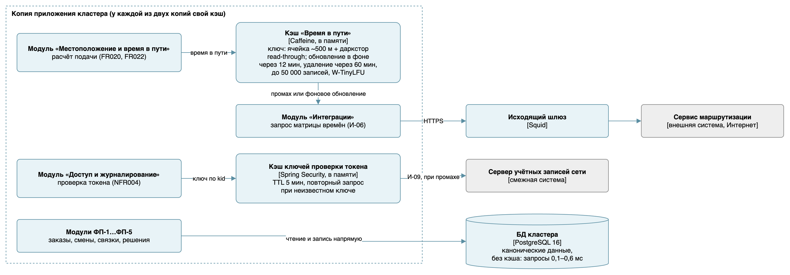

# Кэш и поведение при отказах

## Что кэшировать

Кэшируются только данные с дорогим промахом и редкими изменениями. Остальное читается из БД напрямую: по замерам стенда запросы занимают доли миллисекунды. Выбор технологии — [ADR-017](adr/ADR-017-cache.md).

| Данные | Кто и как часто читает | Цена промаха | Как меняются | Решение |
|---|---|---|---|---|
| Время в пути из сервиса маршрутизации | Пересчёт прогноза раз в 20 с для до 100 курьеров и трёх дарксторов; выдача направления — до 20 в минуту | Вызов внешнего сервиса через исходящий шлюз: сотни миллисекунд на пути к лимиту 2 с (NFR001) и зависимость от доступности сервиса | С дорожной обстановкой, за десятки минут | Кэшировать |
| Ключи проверки токена | Каждый запрос API | HTTPS-запрос к серверу учётных записей (И-09) | При смене ключей, редко | Кэшировать |
| Заказы, смены, связки, направления | Все модули постоянно | 0,1–0,6 мс (модели данных v2) | На каждое событие | Не кэшировать: выигрыша нет, а копия в памяти рискует разойтись с БД (NFR002) |
| Справочники и пороги | Пересчёт прогноза | Доли миллисекунды | Редко | Не кэшировать: выигрыш — микросекунды |
| Витрина | Модуль «Контроль сроков» по запросу | Миллисекунды | Раз в сутки | Не кэшировать: запросов единицы в день |

## Параметры кэшей

| Параметр | Время в пути | Ключи проверки токена |
|---|---|---|
| Паттерн | Read-through: кэш сам загружает значения; промахи одного цикла пересчёта запрашиваются одним вызовом матрицы | Cache-aside внутри Spring Security |
| Ключ | Ячейка карты около 500 м и даркстор | Идентификатор ключа kid |
| Срок жизни | Обновление в фоне через 12 мин после загрузки (refreshAfterWrite): при работающем сервисе значение не старше 15 мин. Удаление через 60 мин (expireAfterWrite): дольше на старом значении система не работает, даже если сервис недоступен | 5 мин |
| Основание срока | В требованиях срок не задан. Дорожная обстановка меняется за десятки минут; целевая свежесть 15 мин — предположение, которое проверяет метрика М-6 (ошибка подачи): если она растёт, интервал обновления уменьшается | Ключ действует до смены; новый ключ подхватывается сразу (строка ниже) |
| Инвалидация | По сроку; при изменении состава кластера (FR010) удаляются ключи изменившегося даркстора; администратор может очистить кэш через точку администрирования | Токен с неизвестным kid вызывает немедленный повторный запрос ключей |
| Вытеснение | Не больше 50 000 записей, политика W-TinyLFU | Не нужно: один набор ключей |
| Защита от cache stampede | Один загрузчик на ключ: параллельные запросы ждут его результата; фоновое обновление отдаёт старое значение до прихода нового; пакетная загрузка вместо запроса на каждый ключ | Один запрос обновления на все потоки |
| Прогрев | При старте копии матрица для ячеек открытых смен загружается до приёма запросов | При первом запросе |

Кэш хранит только копии ответов внешних систем. Канонические данные — заказы, смены, связки и решения — остаются в БД кластера, поэтому отключение кэша ничего не теряет.

## Таблица отказов

| Ситуация | Как обнаруживается | Поведение системы | Восстановление | Потеря данных |
|---|---|---|---|---|
| Кэш отключён или копия перезапущена | Метрики Micrometer: доля попаданий, число загрузок | Время в пути запрашивается у сервиса напрямую, пакетами по циклу пересчёта | Прогрев при старте | Нет |
| Сервис маршрутизации недоступен | Ошибки загрузки кэша | Фоновое обновление не удаётся, используется прежнее значение — не дольше 60 мин после загрузки; если его нет — направление на базовый даркстор, как при превышении 2 с (FR029) | Автоматически после восстановления | Нет |
| Время в пути устарело | Рост ошибки подачи М-6 | При работающем сервисе значение не старше 15 мин | Уменьшить интервал обновления | Нет |
| Сервер учётных записей недоступен | Ошибки обновления ключей | Действуют закэшированные ключи; токены с новым ключом отклоняются | Автоматически | Нет |
| Потеря витрины | Мониторинг базы mart, ошибки API отчётов | Распределение поездок и оперативные отчёты работают; динамика недоступна | Ночная резервная копия; последние 90 дней — повторной загрузкой из d05 | Только версии даркстора, изменённые после последней резервной копии: версии порогов хранятся в DistributionParameter, а факты старше 90 дней не меняются и есть в копии |
| Запаздывание обновления | Проверка свежести в 06:00, отставание слота | Потребители видят дату актуальности и данные предыдущей загрузки | Повторный запуск загрузки: она идемпотентна | Нет |
| Витрина недоступна дольше лимита журнала изменений | Размер слота, оповещение на половине лимита | Слот сбрасывается, БД кластера защищена от переполнения | Новая подписка с копированием текущих данных | Только при простое дольше 90 дней |
| Нарушение согласованности витрины | Проверки качества, журнал load_aud | Загрузка суток откатывается, агрегаты не обновляются | Разбор, исправление, повторная загрузка | Нет |
